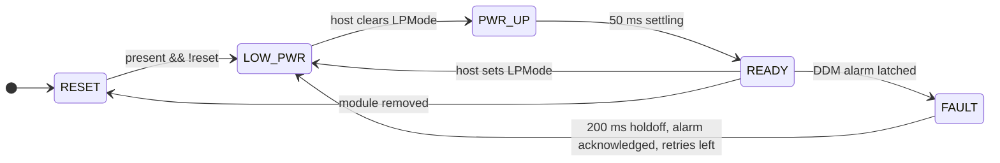

# OptiLink

Firmware for the controller inside a pluggable optical transceiver.

It does four jobs:

- keeps the CMIS management memory map that the host reads over I2C
- samples the module's analog monitors and checks them against alarm thresholds
- runs the module and per-lane data path state machines that bring the optical
  link up and shut it down
- inspects Layer 2 frames on the management data path

The same C sources build two ways. `make arm` cross-compiles a Cortex-M4
image. `make host` builds a desktop binary where the HAL uses ordinary memory
and a pipe instead of real hardware. All the code above the HAL is identical in
both builds, so the tests run the same code that would ship.

```
$ make test && make pytest
282 checks, 0 failures
54 passed in 0.60s
```

### Where to look

| If you want to see | Open |
|---|---|
| The one place that knows the hardware | `firmware/include/optilink/hal.h`, `firmware/hal/hal_cortexm.c`, `firmware/hal/hal_host.c` |
| Register-level drivers | `firmware/drivers/i2c.c` (I2C target), `firmware/drivers/uart.c` |
| Startup code, interrupts and linker script | `firmware/hal/startup_cortexm.c`, `firmware/hal/cortexm_irq.h`, `firmware/hal/cortexm.ld` |
| The scheduler and the ring buffer the console reads from | `firmware/src/sched.c`, `firmware/src/ringbuf.c` |
| The CMIS memory map and alarm latching | `firmware/src/cmis.c`, `firmware/src/ddm.c` |
| Debounce and the link state machines | `firmware/src/link.c` |
| Unit tests (C) and integration tests (pytest) | `tests/unit/`, `tests/integration/` |
| What has not been tested | [Scope](#scope) |

---

## Why it is built this way

Firmware is hard to test well because proper testing needs hardware, and
hardware is scarce, slow and shared. Three choices here work around that.

**One HAL boundary instead of many mocks.** `firmware/include/optilink/hal.h`
is the only place that knows what the code is running on. Two files implement
it: `hal_cortexm.c` drives real peripherals and `hal_host.c` fakes them. No
code above the HAL has an `#ifdef`. Mocking each module separately would mostly
test the mocks.

**A virtual clock.** On the host build, `hal_wait_for_tick()` only moves time
forward when the test tells it to, with a `tick <n>` console command. A test
that asks what happens 200 ms after a laser fault gets the same answer every
time, without sleeping:

```python
live.inject("los", 1, 1)
live.tick(20)
assert live.link()["lanes"][1]["state"] == "ACTIVATED"   # debounce holds
live.tick(20)
assert live.link()["lanes"][1]["state"] == "FAULT"       # and then trips
```

This is why the 54 integration tests run in 0.6 seconds and none of them are
flaky.

**Fault injection can't reach the real build.** Every `hal_sim_*` function is
behind `OPTILINK_HOST_SIM`, which the target build sets to 0. A build that can
be told to fake a laser fault should never reach a customer. Because this is
decided at compile time, the linker enforces it, not a code reviewer.

---

## Architecture

```
        host (line card)
              |  I2C @ 0x50                     UART 115200
              v                                      |
      +---------------+                              v
      |  i2c target   |  drivers/i2c.c        +-------------+
      +-------+-------+                       | uart + cli  |
              |                               +------+------+
              v                                      |
      +---------------+   thresholds   +-------------v------+
      |  cmis memory  |<-------------->|   eth L2 parser    |
      |  map (paged)  |                +--------------------+
      +---+-------+---+
          |       |
     live |       | alarms
   values |       v
          |  +---------------+     squelch TX     +-----------+
          +->|  ddm monitors |------------------->|  link SM  |
             +-------+-------+                    +-----+-----+
                     |                                  |
                     v                                  v
             +-------------------------------------------------+
             |     hal.h    (hal_cortexm.c | hal_host.c)        |
             +-------------------------------------------------+
```

A cooperative scheduler with fixed priorities runs four periodic tasks to
completion on one stack:

| task | period | priority | job |
|------|--------|----------|-----|
| `cli`  | 1 ms   | 0 | drain the UART ring, handle one console line |
| `link` | 10 ms  | 1 | debounce inputs, step both state machines |
| `ddm`  | 100 ms | 2 | sample monitors, evaluate thresholds |
| `cmis` | 100 ms | 3 | publish live values into the memory map |

The console has the highest priority because a module that doesn't answer on
its debug port can't be diagnosed. The link task runs every 10 ms because the
debounce is three samples and the link has 30 ms to qualify.

### The state machines



Below the module machine, each lane runs its own data path machine:
`DEACTIVATED → INIT → TX_TURN_ON → ACTIVATED`, and any state can go to `FAULT`.
Lanes are separate because they fail separately. One dirty fibre should turn
off one lane, not all four.

---

## Design decisions

**Alarm flags latch and clear when read.** If a laser browns out for 40 ms and
recovers, a host that polls once a second still needs to see it. Without
latching, the dip is missed and the link looks healthy until it actually fails.
Real SFF-8636 and CMIS parts clear flags on read too, which is why `cmis_read()`
can't be a const function.

**A faulted lane is turned off straight away.** `lane_enter(DP_FAULT)` calls
`hal_tx_enable(lane, false)` before anything else. Leaving a laser on for a
lane the firmware has given up on is a risk to the link and to eye safety. The
C# checker tests this on every reading.

**Retries are capped, with a wait between them.** A lane that can't come up
stays in `FAULT` after five attempts instead of cycling its laser forever. A
module that stays down, and says so, is easier to deal with than one that keeps
flapping.

**A missed period is counted, not made up.** If the scheduler finds a task a
full period late, it runs it once, resets its timing to now, and adds one to an
overrun counter. Running every missed period would hog the loop and starve the
lower-priority tasks, so one slow job could take the whole system down.

**The console makes no decisions of its own.** `cmd_frame` passes oversize
frames to `eth_parse` instead of rejecting them itself. That keeps the parser's
reject path reachable from outside, so it can be tested. If the console had its
own copy of the length rule, the parser's check could never be hit.

**A 16-entry CRC table.** The usual CRC-32 table has 256 entries and takes 1 KB.
A 16-entry table (one per 4-bit nibble) takes 64 bytes and is still about four
times faster than computing it bit by bit. For the frame rates a management
path sees, the small table is the better trade.

**No `printf`.** `uart_printf` is about 90 lines and supports `%c %s %d %u %x`
with zero-padding and a width. newlib's `printf` costs several kilobytes of
flash and pulls in `malloc`, and this chip only needs a management console.

---

## Testing

Four layers, each catching things the others can't.

| layer | what it covers | run it |
|-------|----------------|--------|
| C unit tests | module logic on its own: ring buffer wraparound, CRC test vectors, threshold latching, scheduler overruns | `make test` |
| Sanitizers | out-of-bounds access and undefined behaviour in the frame parser, which has to handle hostile input | `make asan` |
| Integration | the whole image running on the virtual clock: bring-up timing, debounce, which lane a fault is blamed on, recovery, and the memory map as a host sees it | `make pytest` |
| Reconciliation | traffic sent compared with the device's own counters | `make traffic` |

Reconciliation is the check that finds parser bugs. Counting what a generator
sent is easy. Comparing it with the counters the device reports is what shows
up a kind of frame the firmware drops without saying so:

```
$ python tools/trafficgen.py --frames 5000 --corrupt-rate 0.15
sent          5000  (4193 clean, 807 corrupted)
accepted      4193
  rejected BAD_FCS    807
elapsed       0.24s  (20973 frames/s)
device counters:
  frames     5000
  fcs_err    807
  vlan       1820
  qinq       511
  uc         4518
  bc         482
reconciled: device counters match what was sent
```

`tools/LinkMon` is a C# console tool that shows the module's telemetry and
checks it for contradictions: the active-lane mask has to match the per-lane
states, no faulted lane can still have its laser on, and a module with an alarm
can't report itself as ready. A dashboard that displays contradictory
telemetry without flagging it would make a wrong number look trustworthy.

```
$ dotnet run --project tools/LinkMon -- --self-test
127 invariants checked, 0 violations
┌─ OptiLink 1.0.0 ── module READY    link UP    mask 0x0F ─┐
│ temperature    40.0 C     supply  3.300 V     faults   1      │
├───────────────────────────────────────────────────────────────┤
│ lane  state        tx    bias      tx pwr    rx pwr   fault    │
│  0    ACTIVATED    on     35.0mA   1.000mW   0.800mW  DDM_ALARM│
└───────────────────────────────────────────────────────────────┘
```

---

## Building

```bash
scripts/setup.sh          # reports what is missing, installs pytest
make host                 # desktop binary
make test                 # C unit tests
make pytest               # integration suite
scripts/run_tests.sh      # everything CI runs, in the order CI runs it
```

For the target, with `arm-none-eabi-gcc` installed:

```bash
make arm                  # cross build plus a size report
make size-check           # fails if the image outgrows 128K flash / 32K RAM
```

The current image, built with `arm-none-eabi-gcc 15.2.1` for Cortex-M4 at `-Os`:

```
flash   10368 / 131072  [###.............................]   7.9%
ram      8792 / 32768   [#########.......................]  26.8%
```

Most of that RAM is the debug console: the console line buffer is 3,200 bytes
and the frame scratch buffer is 1,590. That's on purpose, because both let the
parser and the command interface be driven from outside with realistic input.
They would be the first thing to shrink for a smaller chip.

The target build only needs a compiler and a linker script. There is no vendor
HAL package or CMSIS download. The registers the port uses are declared in
`hal_cortexm.c`.

CI runs the host build and tests on Linux, Windows and macOS, and the
sanitizers and cross build on Linux. The `Jenkinsfile` has the same stages,
because firmware often ends up building on the machine the board is plugged
into rather than a cloud runner. Both call the same `make` targets, so there is
one definition of a passing build.

---

## Layout

```
firmware/
  include/optilink/   public headers, one per module
  src/                scheduler, CMIS map, DDM, link SMs, L2 parser, CLI
  drivers/            I2C target, UART console
  hal/                hal_host.c, hal_cortexm.c, startup, linker script
tests/
  unit/               C tests and a ~40 line test framework
  integration/        pytest suites and the harness that drives the firmware
tools/
  trafficgen.py       frame builder, corruption, loss reconciliation
  LinkMon/            C# telemetry viewer and invariant checker
scripts/              environment setup, the full CI sequence, size gate
```

---

## Scope

This runs against a simulated HAL. There is no physical transceiver, no real
I2C bus and no real optics. The analog monitors are values in an array and the
lane signals are booleans that a test sets.

So the logic above the HAL is fully tested, and the Cortex-M port compiles,
links and fits its memory budget. What has **not** been tested is that port on
real silicon: the order peripherals are initialised in, I2C clock stretching
when the host holds the bus, ADC settling time, and whether the SysTick divider
matches the board's real clock setup. A simulated HAL can't answer those
questions. A clean cross-compile shows the code builds, not that it works on
hardware.

The register maps, CMIS offsets, monitor scaling and default thresholds follow
the real specifications. The memory map is a working subset (identity, module
state, latched flags, module and per-lane monitors, thresholds and lane
control), not all of CMIS 5.0.
