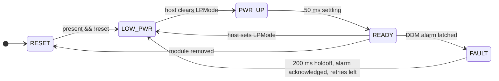

# OptiLink

Firmware for the controller inside a pluggable optical transceiver.

It owns the CMIS management memory map the host reads over I2C, samples the
module's analog monitors and compares them against alarm thresholds, runs the
module and per-lane data path state machines that bring the optical link up
and tear it down, and inspects Layer 2 frames on the management data path.

The same C sources build two ways. `make arm` cross-compiles a Cortex-M4
image; `make host` builds a desktop binary where the HAL is backed by ordinary
memory and a pipe instead of silicon. Everything above the HAL is byte for
byte identical between them, so the test suite exercises the code that ships
rather than a reimplementation of it.

```
$ make test && make pytest
282 checks, 0 failures
54 passed in 0.60s
```

---

## Why it is built this way

Firmware is usually tested badly because testing it properly needs hardware,
and hardware is scarce, slow and shared. Three decisions here exist to avoid
that.

**A HAL seam, not a mock layer.** `firmware/include/optilink/hal.h` is the
only place that knows what the code is running on. Two files implement it:
`hal_cortexm.c` drives real peripherals, `hal_host.c` fakes them. Nothing
above the seam has a `#ifdef` in it. The alternative — mocking individual
modules — would test the mocks.

**A virtual clock.** The host port's `hal_wait_for_tick()` only advances time
when the test says so, via a `tick <n>` console command. So a test asking what
happens 200 ms after a laser fault gets a deterministic answer instead of
sleeping and hoping:

```python
live.inject("los", 1, 1)
live.tick(20)
assert live.link()["lanes"][1]["state"] == "ACTIVATED"   # debounce holds
live.tick(20)
assert live.link()["lanes"][1]["state"] == "FAULT"       # and then trips
```

That is the entire reason 54 integration tests run in 0.6 seconds and none of
them are flaky.

**Fault injection that cannot ship.** Every `hal_sim_*` entry point is behind
`OPTILINK_HOST_SIM`, and the target build sets it to 0. A build that can be
told to fake a laser fault is not a build that should reach a customer, and
putting the seam at compile time makes that the linker's guarantee rather than
something a reviewer has to notice.

---

## Architecture

```
        host (line card)
              |  I2C @ 0x50                     UART 115200
              v                                      |
      +---------------+                              v
      |  i2c target   |  drivers/i2c.c        +-------------+
      +-------+-------+                       | uart + cli  |
              |                               +------+------+
              v                                      |
      +---------------+   thresholds   +-------------v------+
      |  cmis memory  |<-------------->|   eth L2 parser    |
      |  map (paged)  |                +--------------------+
      +---+-------+---+
          |       |
     live |       | alarms
   values |       v
          |  +---------------+     squelch TX     +-----------+
          +->|  ddm monitors |------------------->|  link SM  |
             +-------+-------+                    +-----+-----+
                     |                                  |
                     v                                  v
             +-------------------------------------------------+
             |     hal.h    (hal_cortexm.c | hal_host.c)        |
             +-------------------------------------------------+
```

Four periodic tasks, run to completion from one stack by a fixed-priority
cooperative scheduler:

| task | period | priority | job |
|------|--------|----------|-----|
| `cli`  | 1 ms   | 0 | drain the UART ring, handle one console line |
| `link` | 10 ms  | 1 | debounce inputs, step both state machines |
| `ddm`  | 100 ms | 2 | sample monitors, evaluate thresholds |
| `cmis` | 100 ms | 3 | publish live values into the memory map |

The console outranks the link because a module that will not answer its debug
port is a module nobody can diagnose. The link task runs at 10 ms because the
debounce is three samples and the qualification budget is 30 ms.

### The state machines



Underneath, each lane runs its own data path machine —
`DEACTIVATED → INIT → TX_TURN_ON → ACTIVATED`, with `FAULT` reachable from
any of them. Lanes are separate because they fail separately: one dirty fibre
should dark one lane, not the other three.

---

## Design decisions worth arguing about

**Alarm flags latch and clear on read.** A laser that browns out for 40 ms and
recovers must still be visible to a host polling once a second. Without
latching the excursion is invisible and the link looks healthy right up until
it fails. Read-to-clear is what real SFF-8636 and CMIS parts do, and it means
`cmis_read()` cannot be a const operation.

**A faulted lane is darked immediately.** `lane_enter(DP_FAULT)` calls
`hal_tx_enable(lane, false)` before anything else. A lit transmitter on a lane
the firmware has already given up on is both a link hazard and an eye safety
one. The C# validator checks this invariant on every reading.

**Retries are capped, with a holdoff.** A lane that cannot come up settles in
`FAULT` after five attempts instead of cycling its laser for the life of the
system. A module that stays down and visible is more useful than one that
flaps.

**A missed period is counted, not replayed.** If the scheduler finds a task a
full period late it runs it once, resyncs to now, and increments an overrun
counter. Replaying the backlog would monopolise the loop and starve every task
below it — the failure mode where one slow job takes the whole system down
with it.

**The console owns no policy.** `cmd_frame` hands oversize frames to
`eth_parse` rather than rejecting them itself, so the parser's reject path is
reachable from outside and therefore testable. A console that duplicated the
parser's length rule would have made that path dead code.

**A nibble-wide CRC table.** The usual byte-wide CRC-32 table is 1 KB. Sixteen
entries cost 64 bytes and still run about four times faster than the bit-wise
loop. At the frame rates a management path sees, the small table is the right
end of the trade.

**No `printf`.** `uart_printf` is about 90 lines and supports `%c %s %d %u %x`
with zero-padding and a width. Pulling in newlib's costs several kilobytes of
flash and drags in `malloc`, neither of which belongs on a part whose entire
job is a management console.

---

## Testing

Four layers, each catching what the others cannot.

| layer | what it covers | run it |
|-------|----------------|--------|
| C unit tests | module logic in isolation — ring buffer wraparound, CRC vectors, threshold latching, scheduler overruns | `make test` |
| Sanitizers | out-of-bounds and undefined behaviour in the frame parser, which walks attacker-shaped input | `make asan` |
| Integration | the whole image running on a tick: bring-up timing, debounce, fault attribution, recovery, the memory map as a host sees it | `make pytest` |
| Reconciliation | offered load against the device's own counters | `make traffic` |

The reconciliation check is the one that finds parser bugs. Any generator can
count what it transmitted; what catches a frame class the firmware silently
drops is comparing that against the counters the device reports:

```
$ python tools/trafficgen.py --frames 5000 --corrupt-rate 0.15
sent          5000  (4193 clean, 807 corrupted)
accepted      4193
  rejected BAD_FCS    807
elapsed       0.24s  (20973 frames/s)
device counters:
  frames     5000
  fcs_err    807
  vlan       1820
  qinq       511
  uc         4518
  bc         482
reconciled: device counters match what was sent
```

`tools/LinkMon` is a C# console tool that renders the module's telemetry and
checks a set of invariants against it — that the active-lane mask agrees with
the per-lane states, that no faulted lane is still lit, that a module carrying
an alarm is not advertised as ready. A dashboard that faithfully renders
inconsistent telemetry is worse than no dashboard, because it lends authority
to a wrong number.

```
$ dotnet run --project tools/LinkMon -- --self-test
127 invariants checked, 0 violations
┌─ OptiLink 1.0.0 ── module READY    link UP    mask 0x0F ─┐
│ temperature    40.0 C     supply  3.300 V     faults   1      │
├───────────────────────────────────────────────────────────────┤
│ lane  state        tx    bias      tx pwr    rx pwr   fault    │
│  0    ACTIVATED    on     35.0mA   1.000mW   0.800mW  DDM_ALARM│
└───────────────────────────────────────────────────────────────┘
```

---

## Building

```bash
scripts/setup.sh          # reports what is missing, installs pytest
make host                 # desktop binary
make test                 # C unit tests
make pytest               # integration suite
scripts/run_tests.sh      # everything CI runs, in the order CI runs it
```

For the target, with `arm-none-eabi-gcc` installed:

```bash
make arm                  # cross build plus a size report
make size-check           # fails if the image outgrows 128K flash / 32K RAM
```

The current image, built with `arm-none-eabi-gcc 15.2.1` for Cortex-M4 at `-Os`:

```
flash   10368 / 131072  [###.............................]   7.9%
ram      8792 / 32768   [#########.......................]  26.8%
```

Worth knowing where that RAM goes: the console line buffer is 3,200 bytes and
the frame scratch is 1,590, so the debug console alone accounts for well over
half of it. That is a deliberate trade — both exist so the parser and the
command interface can be driven from outside with realistic inputs — but it is
the first thing to shrink if this ever has to fit a smaller part.

Only a compiler and a linker script are required — no vendor HAL package, no
CMSIS download. The register maps the port needs are declared in
`hal_cortexm.c`.

CI runs the host build and tests on Linux, Windows and macOS, sanitizers and
the cross build on Linux. `Jenkinsfile` mirrors it stage for stage, because
firmware usually ends up building on the machine with the board attached
rather than on a cloud runner. Both shell out to the same `make` targets, so
there is one definition of what passing means.

---

## Layout

```
firmware/
  include/optilink/   public headers, one per module
  src/                scheduler, CMIS map, DDM, link SMs, L2 parser, CLI
  drivers/            I2C target, UART console
  hal/                hal_host.c, hal_cortexm.c, startup, linker script
tests/
  unit/               C tests and a ~40 line test framework
  integration/        pytest suites and the harness that drives the firmware
tools/
  trafficgen.py       frame builder, corruption, loss reconciliation
  LinkMon/            C# telemetry viewer and invariant checker
scripts/              environment setup, the full CI sequence, size gate
```

---

## Scope

This runs against a simulated HAL. There is no physical transceiver, no real
I2C bus and no real optics — the analog monitors are values in an array and
the lane discretes are booleans a test sets.

What that means in practice: the logic above the HAL is genuinely exercised,
and the Cortex-M port compiles, links and fits its budget. What has **not**
been proven is that port against real silicon — peripheral initialisation
order, I2C clock stretching under a host that holds the bus, ADC settling
time, whether the SysTick divisor matches the clock tree the board actually
brings up. Those are exactly the things a simulated HAL cannot tell you, and
it would be dishonest to claim otherwise. A clean cross-compile says the code
is well-formed, not that it works.

The register maps, CMIS offsets, monitor scaling factors and threshold
defaults are modelled on the real specifications. The memory map is a working
subset — identity, module state, latched flags, module and per-lane monitors,
thresholds and lane control — not the whole of CMIS 5.0.
